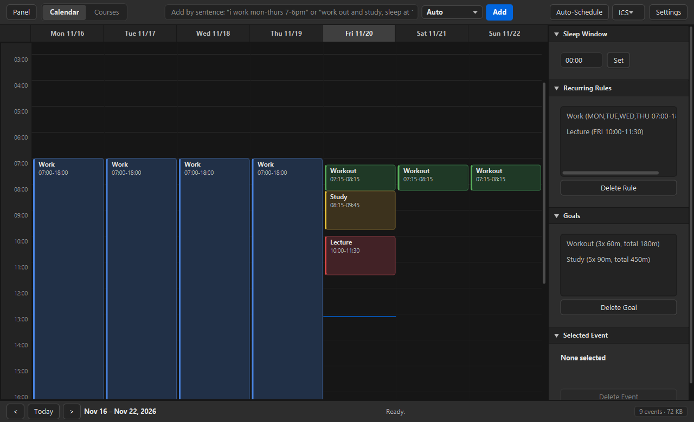
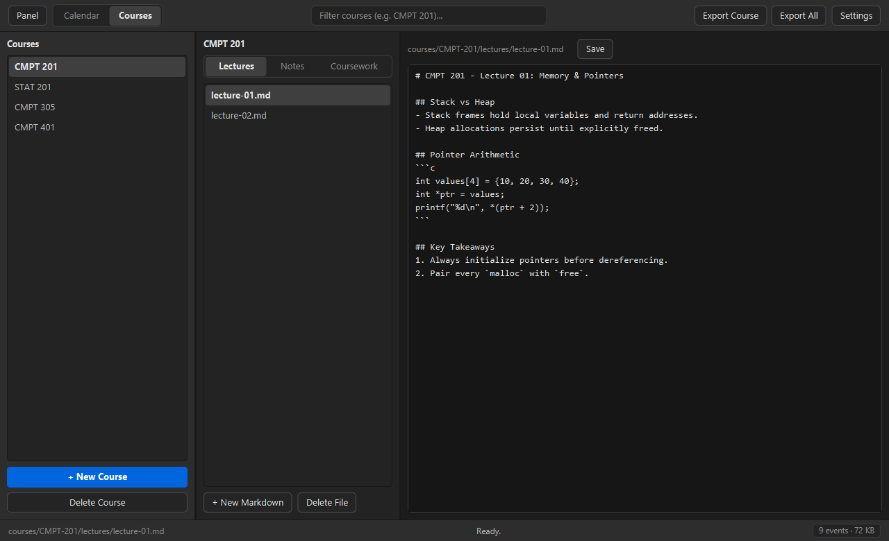

# calendar-organizer

A local-first Windows desktop app in two parts:

1. **Calendar Builder**: Enter plain sentences like `"i work mon-thurs 7-6pm"` or `"i want to work out and study, i'm busy at 8pm for 2 hours, and i want to sleep at 12"`. Fixed blocks, recurring blocks, sleep hours, and workout/study goals are saved locally in SQLite and scheduled deterministically without overlaps. You can also **manually add, edit, and adjust timings like Google Calendar**: click-and-drag (or double-click) any empty slot to create an event, drag existing events up/down to move them, drag an event's bottom edge to resize its duration, double-click any event or recurring rule to edit its details, and hold **`Ctrl + Scroll`** to zoom the calendar grid in and out. Supports importing Google Calendar `.ics` exports (from file or pasted text) and exporting back to `.ics`.
2. **Course Organizer**: Organizes courses numerically by course number (for example `MATH 99`, `CMPT 201`, `STAT 201`, `CMPT 1000`) with real disk folders (`courses/CMPT-201/lectures/`, `notes/`, `coursework/`). Supports writing markdown notes, **dragging & dropping PowerPoint (`.pptx`/`.ppt`), PDF (`.pdf`), Word (`.docx`), or image files** directly into a course section, sorting files **alphabetically (A-Z / Z-A) or by timing (Newest first / Oldest first)**, **in-app built-in previews** (lazy virtualized PDF page scrolling with `< Prev` / `Next >` navigation, `-` / `+` / `Fit` and `Ctrl + Scroll` zoom, and automatic cache release on tab switch or exit, plus extracted `.pptx` slides + speaker notes + thumbnail, `.docx`/text preview, and image preview), plus one-click **Open File** and **Open Folder** buttons. Exports a single course or all courses into a `.zip` of clean markdown (`README.md`, normalized per-section `.md` files, and `combined.md`) ready to pass to another LLM for studying.

## Screenshots

### Calendar Builder


### Course Organizer


## UI Themes, AI Settings & Cleanup

Open **Settings** from the top-right bar to:
- Switch themes live between **Charcoal (Dark)** (default), **Midnight (OLED Dark)**, and **Paper (Light)**.
- Optionally save a **Gemini API key** (stored locally, masked input) or configure a local **Ollama** host and model without touching terminal environment variables.
- Inspect live SQLite counts, database disk size, and memory usage.
- Run **Clear Past Events**, **Clear Scheduled Sessions**, **Optimize & Compact Database** (`VACUUM` + `PRAGMA optimize`), or **Reset All Calendar History & Settings** (which leaves your course folders and saved AI/theme preferences untouched).

## Standalone Windows Bundle & Desktop Install

Build the self-contained Windows app bundle (no system Java installation required) with either option:

- **One-command per-user install + Desktop shortcut**:
  ```powershell
  .\scripts\package-windows.ps1 -Install -DesktopShortcut
  ```
  Installs the bundled app into `$env:LOCALAPPDATA\Programs\CalendarOrganizer\` and creates/updates the **Calendar Organizer** shortcut on your Desktop.
- **Portable archive**:
  `.\scripts\package-windows.ps1` outputs `target\dist\CalendarOrganizer\CalendarOrganizer.exe` and `target\dist\CalendarOrganizer-windows-x64.zip` (~48.7 MB), which can be extracted anywhere on Windows 10/11 (x64) and launched directly.

## Requirements (Building from Source)

- Windows 10 or Windows 11 (x64)
- Java 21 JDK (including `jpackage`)
- Apache Maven 3.9+

## Build and Run Tests (PowerShell)

```powershell
mvn test
```

## Run the Application (PowerShell)

```powershell
mvn javafx:run
```

## Optional LLM Parsing Configuration

The built-in `RuleParser` handles common schedule phrases offline with zero configuration. You can enable LLM JSON extraction either inside **Settings** in the app, or via PowerShell environment variables:

### Gemini API
```powershell
$env:GEMINI_API_KEY = "your-gemini-api-key"
mvn javafx:run
```
Optional model override (defaults to `gemini-flash-lite-latest`):
```powershell
$env:GEMINI_MODEL = "gemini-flash-lite-latest"
```

### Local Ollama
Start Ollama locally, then launch (or set Host/Model in **Settings**):
```powershell
$env:OLLAMA_HOST = "http://localhost:11434"
$env:OLLAMA_MODEL = "llama3.2"
mvn javafx:run
```

## Package Standalone App for Windows (PowerShell)

Build the app-image and portable archive:
```powershell
.\scripts\package-windows.ps1
```

Build, install to `$env:LOCALAPPDATA\Programs\CalendarOrganizer\`, and create the Desktop shortcut:
```powershell
.\scripts\package-windows.ps1 -Install -DesktopShortcut
```

This runs `mvn clean package`, builds a trimmed JDK 21 `jpackage` app-image with custom app icon, and outputs both the runnable bundle folder and a portable `.zip` archive:
```powershell
.\target\dist\CalendarOrganizer\CalendarOrganizer.exe
.\target\dist\CalendarOrganizer-windows-x64.zip
```

## Local Data Storage

All calendar events, recurring rules, goals, preferences, and course markdown folders are stored locally under `$env:USERPROFILE\.calendar-organizer`:
- `calendar.db` — SQLite database for calendar data
- `courses\` — plain markdown files organized as `<COURSE>\lectures\`, `notes\`, and `coursework\`

You can override the data folder via `-Dcalendar.organizer.home=...` or `$env:CALENDAR_ORGANIZER_HOME`.
